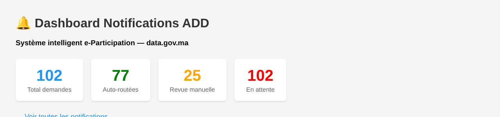
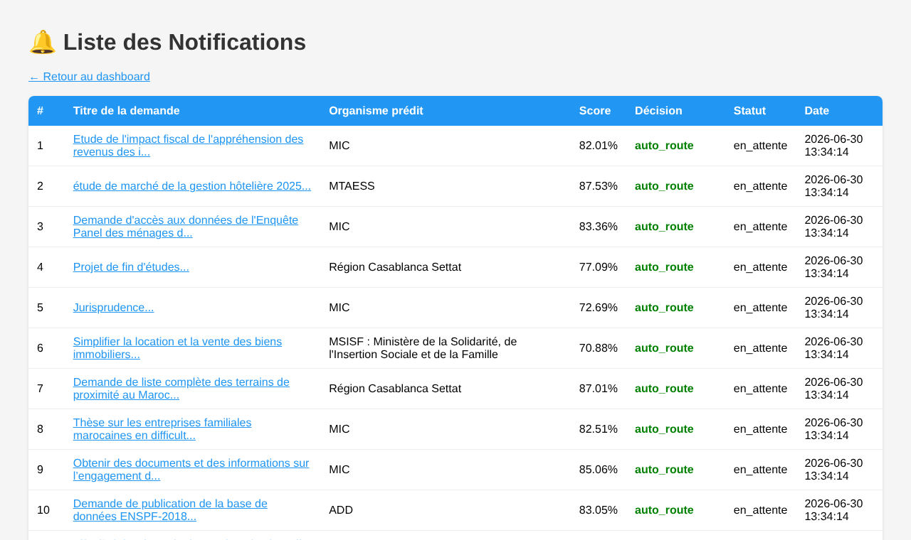

# Citizen Request Router — data.gov.ma e-participation

NLP system that reads citizen data requests posted on Morocco's open data portal **data.gov.ma** and suggests which public organisation should handle each one, with a confidence score. Confident matches are routed automatically; uncertain ones are flagged for manual review. Results are shown in a Flask dashboard.

Internship project (PFA) at the **Agence du Développement du Digital (ADD)**, Rabat — June–July 2026.



## How it works

```
data.gov.ma (CKAN API + feedback pages)
        │
        ├── extract_organisations.py ──► organisations.csv         47 public organisations
        │   enrichir_organisations.py ─► organisations_enriched.csv  + keywords from their datasets
        │   enrichissement_manuel.py      (manual keyword enrichment)
        │
        └── scraper_demandes.py ───────► demandes.csv              102 real citizen requests
                                               │
                     ┌─────────────────────────┴─────────────────────────┐
           lexical_matcher.py                                    semantic_matcher.py
           TF-IDF + cosine similarity                            multilingual embeddings
                     └──────────────► hybrid_matcher.py ◄────────────────┘
                              score = 0.65 × lexical + 0.35 × semantic
                              decision: auto_route if top-1 ≥ 0.40 and margin ≥ 0.03
                                               │
                     build_notifications.py ──► notifications.db (SQLite)
                                               │
                                app.py ──► Flask dashboard (localhost:5000)
```

- **Lexical matching:** TF-IDF vectors of the request vs. each organisation's profile (name, description, dataset keywords)
- **Semantic matching:** `paraphrase-multilingual-MiniLM-L12-v2` (Sentence-Transformers) — handles French and Arabic phrasing; organisation embeddings are cached on first run
- **Hybrid decision:** weighted score, then a confidence threshold and a minimum margin between the 1st and 2nd suggestion decide between `auto_route` and `manual_review`
- **Advisory system:** nothing is sent automatically — an administrator reviews the suggestions in the dashboard



## Results

| Metric | Value |
|---|---|
| Requests processed | 102 |
| Auto-routed | **77 (75 %)** |
| Sent to manual review | 25 (25 %) |
| Top-1 accuracy (25 manually labelled requests) | 24 % (6/25) |
| Top-3 accuracy | 28 % (7/25) |

The evaluation set is small (25 requests), several requests are ambiguous, and many organisations cover close domains, so these figures are a proof of concept. Next steps: a larger labelled set, embeddings adapted to Moroccan administrative vocabulary, and learning from the administrators' corrections.

Evaluation details: `evaluation.py`, `feedbacks_eval.csv` (labels), `rapport_evaluation.csv` (per-request results).

## Run it

```bash
pip install -r requirements.txt

# Dashboard with the included results
python app.py                      # → http://127.0.0.1:5000

# Full pipeline (needs internet: data.gov.ma + model download on first run)
python extract_organisations.py
python enrichir_organisations.py
python enrichissement_manuel.py
python scraper_demandes.py
python build_notifications.py
python evaluation.py
```

## Data

All data comes from the public portal [data.gov.ma](https://data.gov.ma) (organisations via the CKAN API, requests from the public feedback pages). Contact details appearing inside request texts have been masked.

## Tech stack

Python 3.13 · pandas · scikit-learn (TF-IDF) · Sentence-Transformers · Flask · SQLite · requests · BeautifulSoup

## Author

**Riyad Nouar** — Computer Engineering student (Cybersecurity), UIR
